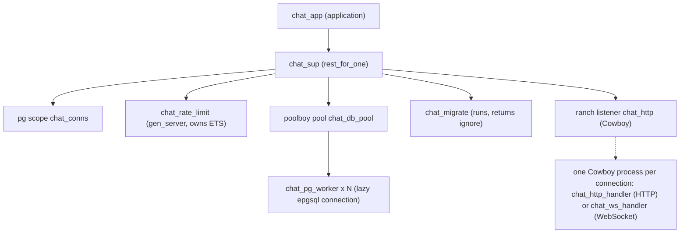

# Architecture

Modular monolith on a single Erlang node. No distributed Erlang is used by the application (the release binds the distribution port to loopback only).

## Supervision tree (actual, Milestone 4)

Why `rest_for_one`: children are listed in dependency order. If `pg` dies, its connection groups are gone, so everything after it (pool, listener and therefore every connection) restarts with it. If only the listener dies, nothing else is touched. Verified by `backend/test/chat_otp_SUITE.erl` (once compiled).

Deviations from the tree sketched in AGENT.md, and why (ADR 0005): `chat_config` is a plain module backed by `persistent_term` (no process needed); there is no `chat_session_sup`, because Cowboy already runs each connection in its own supervised process; `chat_message_dispatcher` is the module `chat_dispatch` over OTP `pg`. Presence (Milestone 5) is where a dynamic supervisor will be introduced.

## Layers

| Layer | Modules | Rule |
|---|---|---|
| Transport | chat_http_handler, chat_ws_handler | parse, call domain, map result; no business rules |
| Protocol | chat_protocol (+ generated chat_pb) | the only place that knows the wire format |
| Domain | chat_auth, chat_users, chat_conversations, chat_messages, chat_delivery, chat_dispatch | rules, authorization, orchestration |
| Storage | chat_repo (behaviour) -> chat_repo_pg -> chat_db -> chat_db_pool | all SQL lives in chat_repo_pg |
| Infrastructure | chat_config, chat_metrics, chat_rate_limit, chat_migrate | |

## Sending a message (happy path)

1. Client stores the message locally as `pending`, sends `SendMessage{client_message_id}`.
2. `chat_ws_handler` decodes, `chat_protocol:validate/1` checks content, `chat_messages:send/3` rate-limits and checks membership.
3. `chat_repo_pg:insert_message/4`, in ONE transaction: look for an existing `(sender, client_message_id)`; else lock the conversation row, bump `last_seq`, insert the message, advance the sender's own receipt marks.
4. Only after commit: `chat_dispatch:push/3` sends the encoded `ChatMessage` to every member's other live connections (via `pg`), and the sender gets `MessageAccepted{seq}`.
5. Recipient client stores it, sends `DeliveryAck(seq)`; the server advances `last_delivered_seq` and pushes `ReceiptUpdate` to the members, so the sender's UI moves from "sent" to "delivered".

Durability comes first (step 3), delivery second (step 4). A push that never arrives is repaired by `SyncRequest` after reconnect.

## Client (Flutter)

`providers.dart` wires: `AuthRepository` (tokens in the platform secure store), `WsService` (one socket, reconnect with backoff + jitter), `ChatSync` (serial queue: reconnect list -> per-conversation sync -> outbox flush; live pushes with gap detection), and a Drift database used as cache and outbox. UI reads only from the database (`watch` streams), so screens work offline and update themselves when sync writes.
