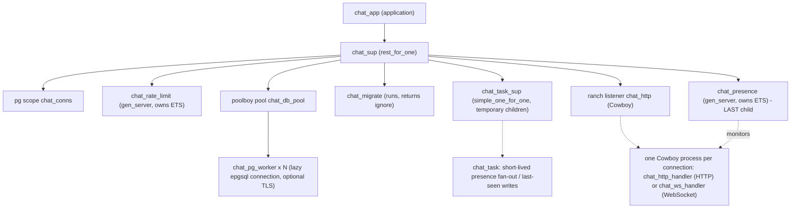

# Architecture

Modular monolith on a single Erlang node. No distributed Erlang is used by the application (the release binds the distribution port to loopback only).

## Supervision tree (actual, Milestone 5)

Why `rest_for_one`: children are listed in dependency order. If `pg` dies, its connection groups are gone, so everything after it (pool, listener and therefore every connection) restarts with it. If only the listener dies, nothing before it is touched.

**Why `chat_presence` is the last child (ADR 0010).** With `rest_for_one`, a crash restarts the crashed child *and everything after it*. Presence is last, so a presence crash restarts presence only: no connection is dropped. On start it rebuilds "who is online" from the `pg` scope (the source of truth for live connections) and re-monitors those pids, so a crash does not make everybody look offline. `chat_presence:connected/2` is a `cast`, so connections never fail or block while presence restarts. Verified by `chat_otp_SUITE:presence_restart_rebuilds_state`.

**Dynamic supervision (ADR 0010).** `chat_task_sup` is a `simple_one_for_one` supervisor: children (`chat_task`) are created at runtime, one per job, are `temporary` (a crashed broadcast is logged, never blindly re-run) and are capped at 500 concurrent tasks (past that, announcements are dropped and counted: they are best-effort and clients re-sync on reconnect). This keeps database queries and fan-out out of the presence process.

Deviations from the tree sketched in AGENT.md, and why (ADR 0005): `chat_config` is a plain module backed by `persistent_term` (no process needed); there is no `chat_session_sup`, because Cowboy already runs each connection in its own supervised process; `chat_message_dispatcher` is the module `chat_dispatch` over OTP `pg`.

## Layers

| Layer | Modules | Rule |
|---|---|---|
| Transport | chat_http_handler, chat_ws_handler | parse, call domain, map result; no business rules |
| Protocol | chat_protocol (+ generated chat_pb) | the only place that knows the wire format |
| Domain | chat_auth, chat_users, chat_conversations, chat_messages, chat_delivery, chat_groups, chat_typing, chat_presence, chat_dispatch | rules, authorization, orchestration |
| Storage | chat_repo (behaviour) -> chat_repo_pg -> chat_db -> chat_db_pool | all SQL lives in chat_repo_pg |
| Infrastructure | chat_config, chat_metrics, chat_rate_limit, chat_migrate, chat_task_sup / chat_task | |

## Sending a message (happy path)

1. Client stores the message locally as `pending`, sends `SendMessage{client_message_id}`.
2. `chat_ws_handler` decodes, `chat_protocol:validate/1` checks content, `chat_messages:send/3` rate-limits and checks membership.
3. `chat_repo_pg:insert_message/4`, in ONE transaction: look for an existing `(sender, client_message_id)`; else lock the conversation row, bump `last_seq`, insert the message, advance the sender's own receipt marks.
4. Only after commit: `chat_dispatch:push/3` sends the encoded `ChatMessage` to every member's other live connections (via `pg`), and the sender gets `MessageAccepted{seq}`.
5. Recipient client stores it, sends `DeliveryAck(seq)`; the server advances `last_delivered_seq` and pushes `ReceiptUpdate` to the members, so the sender's UI moves from "sent" to "delivered".

Durability comes first (step 3), delivery second (step 4). A push that never arrives is repaired by `SyncRequest` after reconnect.

## Presence, typing and groups (Milestone 5)

**Presence.** *Online* = the user has at least one authenticated WebSocket. It is derived, never stored. `chat_ws_handler` tells `chat_presence` about each authenticated connection; presence monitors the pid. When a user's last connection dies, presence waits `CHAT_PRESENCE_GRACE_MS` (default 5 s) before declaring them offline, so a phone that reconnects quickly causes no flicker for peers. Only real transitions are announced, by a `chat_task`, to the user's *peers* (everyone sharing a conversation). Going offline also writes `users.last_seen_at`. Clients ask `GetPresence` after every (re)connect because pushes are best-effort. A user can only query presence of peers; others are silently omitted so presence cannot be probed.

**Typing.** A stateless relay: `TypingEvent` -> `chat_typing:relay/5` -> `TypingUpdate` pushed to the other members. Nothing is stored. Rate-limited (excess is dropped silently: the indicator is cosmetic). Membership is checked against a per-connection cache with a 15 s TTL, so a fast typist does not cost a database query per keystroke; messages never use this cache. Clients throttle sending (one refresh per 3 s) and expire a received indicator after 6 s, which heals every lost "stopped typing".

**Groups.** `chat_groups` implements create / add / remove / leave / rename. The creator is `owner`; only the owner adds, removes or renames; any member may leave; the longest-standing member inherits ownership; an empty group is deleted. Authorization comes from the database on every call. Membership changes lock the conversation row (`FOR UPDATE`), the same row a message insert locks, so a new member's `history_from_seq` is read at a well-defined instant: they never see messages from before they joined (ADR 0011). After each change the current members are pushed the updated `ConversationInfo`; a removed or departed user gets `ConversationRemoved`.

## Client (Flutter)

`providers.dart` wires: `AuthRepository` (tokens in the platform secure store), `WsService` (one socket, reconnect with backoff + jitter), `ChatSync` (serial queue: reconnect list -> per-conversation sync -> outbox flush; live pushes with gap detection), and a Drift database used as cache and outbox. UI reads only from the database (`watch` streams), so screens work offline and update themselves when sync writes. Ephemeral signals (presence, typing) are *not* stored: `ChatSync` hands them to Riverpod notifiers (`presenceProvider`, `typingProvider`) through callbacks, and they reset when the signed-in user changes. While the socket is down presence is shown as unknown rather than stale. The conversation list is reconciled with the server list on every reconnect (conversations we were removed from while away disappear).

Screens: conversation list (search, group avatars, presence dots, typing), chat (live header, typing strip, sender names in groups), conversation/group info (members with presence; owner actions; leave), new group, settings (display name, theme, connection, sign out / sign out everywhere). `HomeShell` provides the two-pane layout and the desktop shortcuts.
